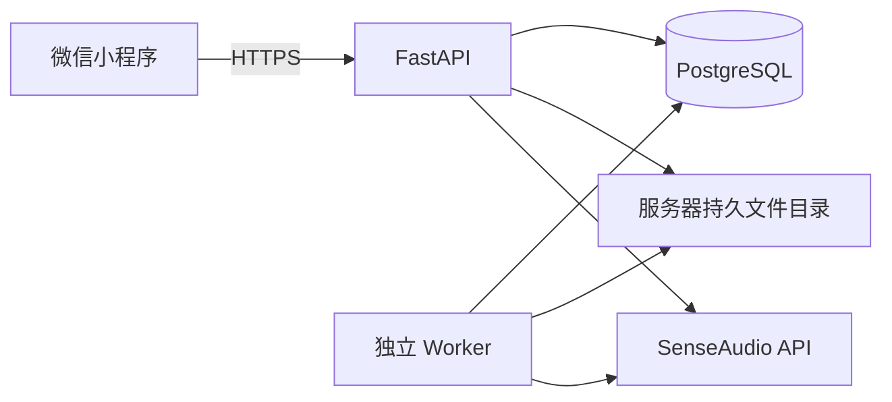

# 当前后端架构

核对日期：2026-09-11。本文描述现有源码，部署现场见 [当前状态](../../docs/CURRENT_STATUS.md)，不包含尚未接入的智能体中台或对象存储。

API 和 Worker 同属模块化单体代码库，进程分开、各自连接池；二者使用同一个 release 的独立 .venv。PG 同时保存业务事实、身份范围、队列、审核与模型产物。小程序通过轮询读取已持久化结果，关闭开发电脑不会停止后端。

## 职责与依赖

HTTP 路由负责参数、身份和事务；service 编排业务；repository 执行参数化 SQL；domain 保存纯规则；contracts 提供请求模型和版本化字段。仓储不反向依赖服务/API，业务服务不导入 API DTO。具体文件及表映射见 [维护入口](../../docs/BACKEND_MAINTENANCE_20260910.md)。

手动保存商机和拜访内商机变更复用同一服务。拜访归档、商机变更及后续任务入队同事务；客户建档与管理下发当前为两个显式请求，不能宣称跨请求天然原子。

## 身份和数据范围

正式管理账号使用密码、角色与部门绑定，演示登录不能进入后台；前端身份标签不能扩大服务端权限。客户运营建档、申请审批、单一有效认领；历史成员只用于兼容，跟进与认领独立；商机按负责销售隔离；主管团队范围、经理工作空间范围。分析运行记录权限版本和身份范围，消息/产物继承运行可见性。

正式企业身份、智能体中台账号同步属于后续接入项；库中的外部 ID 字段不证明外部身份服务已工作。

## 异步、文件与部署

后台领取使用 ops.job 租约令牌和心跳，过期任务可回收，旧处理进程不得提交结果。业务结果与 job_effect 同事务，任务确认丢失时可恢复。外部模型调用无法与数据库组成同一事务，故障窗口可能重复计费。

原始上传文件当前存服务器持久目录，默认 `/var/lib/sales-backend/visit-imports`；任务和转写/解析结果入库。对象存储、向量检索与 OCR 未上线。当前只有小程序经营页面；已有网页管理页不等于独立网页经营看板。

健康探针验证进程、数据库及配置就绪，不证明某次模型调用成功。容量与延迟目标须另做负载测试；本文不承诺固定 P95 或 50—100 人吞吐。发布、备份与监控边界见 [发布手册](../../docs/DEPLOYMENT_RUNBOOK.md)。
