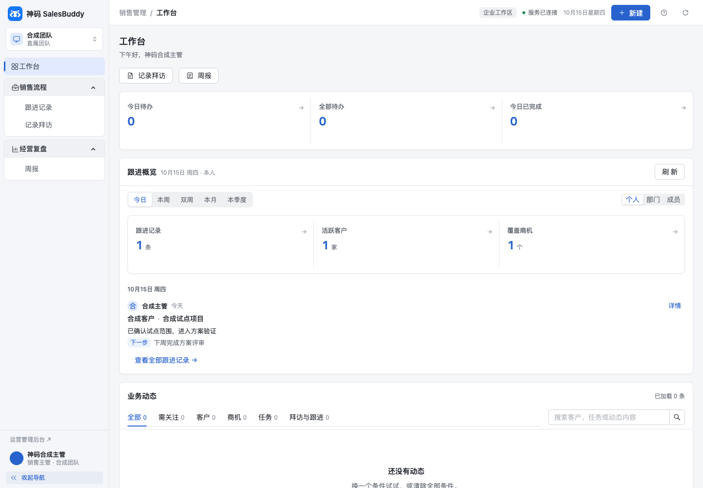
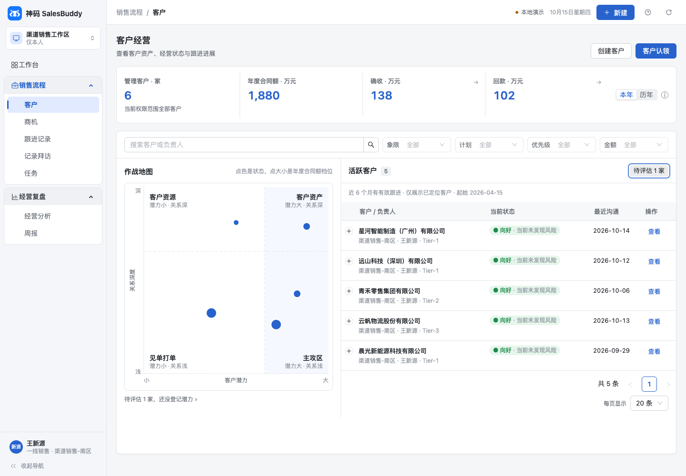
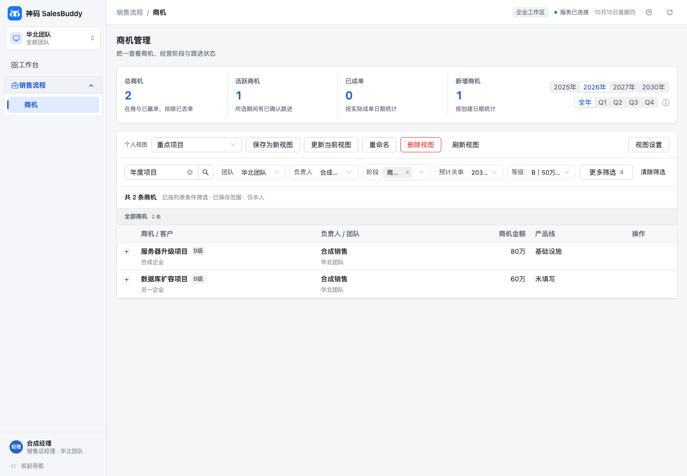
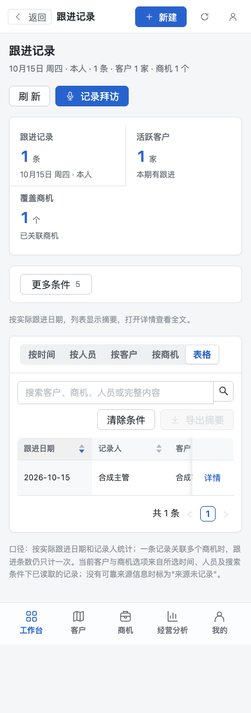

# 神码新版 Web 隔离验收记录

验收日期：2026-10-15。批次：S7A，接续已独立验证的 S2 客户建档、S3 个人商机视图。

## 1. 结论与边界

新版 PC UI、神码已有业务适配及只读跟进范围接口已完成本机隔离实现和本批回归。新增跟进页面使用真实后端契约，权限沿用神码 `visit.read` 与数据库 RLS。不是内部全部 1.2.1 能力迁移完成，也不是正式发布回执。

1. 神码源码起点：`20d8dc60cfb6e6b016ef11a6ac5f0f413056e16f`。
   本批实现已提交为 `e9d09fb1f2d835e2e61fe1779f83f0b0e4b21d04`，配套本地构建 `build.json` 绑定此提交。
2. UI 来源：内部固定 Web `e6099547ddaab0f1e4534c6216e7b9977e3c7368`；未从内部脏工作区复制。
3. 本地数据库候选：V161。本批不增加数据库迁移，V160/V161 属于先前 S2/S3。
4. 本次没有正式环境写入、部署、微信上传、真实模型生成或飞书发送。
5. 线上 API 只读版本仍为 `094841a60c446d88febfdc199be5d0877424193a`，声明 `expected_schema=V159`。16:39 就绪重查为 ok，数据库、模型网关配置、鉴权配置均为 true。此前就绪请求曾超时，保留在原始回执中；配置就绪不证明模型生成效果。

## 2. 实现范围

1. PC 2.0 浅色导航、可折叠分组、面包屑、紧凑顶栏和窄屏账号入口；按权限显示菜单和动作。
2. 工作台承接原任务概览、业务动态与快捷入口，新增跟进周期、本人/部门/成员范围和指标下钻。跟进筛选不会暗改原任务统计。
3. 客户页接入新页头、指标卡、地图、紧凑筛选和分页，承接 S2 申请与运营审批；建档通过仍待认领。
4. 商机页接入新布局与 S3 私人视图设置，保留列顺序、筛选、排序、分组、CRUD、冲突恢复和账号隔离；不增加共享视图权限。
5. 跟进记录支持周期、日期、全文搜索、人员/客户/商机筛选、五种视图、摘要详情和失败恢复。新 `GET /api/v1/visits/range` 查询既有数据，不新增数据读取权限。
6. 周报采用新视觉，原素材口径、生成任务、草稿、历史、取消、确认发布及飞书恢复流程保留。
7. 原全局/列表“新增商机”入口关闭保持，工作台仅提供商机列表入口；八字段详情、元值金额和未确认字段空值保持。

## 3. 实际验证

1. `npm run verify`：构建及 Node 测试 156/156，通过；共享源清单 259 个文件一致，构建 28 页、14 组件。
2. 真实构建浏览器回归 19/19，通过。覆盖 S2 三条流程、客户布局两条、S3 两条、新框架三条、工作台/跟进两条、周报七条，视口 390/1024/1440。浏览器使用合成响应并阻断外网，不作为真实服务器写入证据。
3. `verify_visit_range_api.py`：真实 ASGI HTTP、临时 PostgreSQL、受限 NOSUPERUSER/NOBYPASSRLS 角色，55/55 通过。覆盖销售/主管/总经理/管理员、权限拒绝、团队/人员收窄、跨公司、分页搜索、历史记录、合成数据边界和 S2/S3 回归。临时数据库及角色由脚本清理。
4. route permissions / generated OpenAPI：4/4 通过，静态 `/visits/range` 路由位于动态 `/visits/{visit_id}` 前。
5. 最终源目录与隔离构建输入逐文件 SHA256 对齐；非源码 `.DS_Store` 不计入留存清单。详情见 [证据清单](evidence/WEB_PC_ISOLATED_20261015.json) 和 [输入哈希](evidence/web-pc-20261015/source-sha256.json)。
6. 最终桌面工作台、客户、商机及窄屏跟进截图已查看。截图全部为本机合成数据，不能作为神码真实业务数据。
7. 提交后重新构建并回填本地 `business-web/dist`，74 个文件 SHA256 一致。相较浏览器已测产物，只有 `build.json` 版本/时间及 `index.html`、`entry.js` 中自动生成的资源缓存参数改变；业务 bundle、CSS 逐字节不变，入口去除缓存参数后与已测输入一致。详见 [构建绑定](evidence/web-pc-20261015/dist-sha256.json)。

本批关键命令：

```sh
# 在隔离 business-web 目录执行，依赖来自锁文件
npm run verify
node --test --test-concurrency=1 tests/pc-shenma.browser.mjs tests/pc-foundation.browser.mjs tests/customer-pc-layout.browser.mjs tests/customer-creation-s2.browser.mjs tests/opportunity-views-s3.browser.mjs tests/weekly-live.browser.mjs

# 仅连接本机临时 PostgreSQL；需要配置本地 PGHOST/PGPORT/PGUSER
python backend/tests/system/verify_visit_range_api.py
# 在 backend 目录执行
PYTHONPATH=src python -m pytest -q tests/test_route_permissions.py tests/test_openapi_contract.py
```

## 4. 发现并修复的问题

1. 详情接口缺失关联商机权限字段时，原适配会把范围接口明确拒绝覆盖为允许。现只合并明确权限，缺失时保留原拒绝。
2. 多商机跨客户关联原来丢失每个商机的客户编号。现保留对应客户关系，跳转、分组、筛选与客户去重一致；缺客户访问授权时不打开链接。
3. 快速折叠展开时侧栏与 Ant Menu 状态短暂不一致。现同步切换菜单实例和宽度，保留展开分组；测试连续切换三轮检查实际宽度和文字可见性。
4. 旧移动端账号按钮出现在页面末尾。现迁入窄屏顶栏并沿用原账号对话框，测试确认可打开。
5. 新工作台最初带入全局新增商机快捷入口，与神码定制不符。现改为商机列表入口，并增加保留定制的断言。

## 5. 本次保留和未完成项

1. 本次未调整正式账号、组织、角色、65 人额度、独立演示额度、模型 Key、飞书 Base/群或历史数据。
2. 内部完整商机工作区、结构化字段与人员协作、客户 portfolio、财务预测、工作报告 V3、Review/OKR、新任务筛选仍需配套迁移和验证；CRM 仍等待集团接口条件。
3. 新 UI 本批没有修改原生小程序；既有 S2 小程序源码验证另见 S2 验收，不等同于真机体验或发布。
4. 下一轮发布仍需固定整体范围和包、备份/恢复演练、配套服务部署、真实测试租户联调及业务试用，才能认定神码正式升级完成。

配套资料：[适配与待迁能力](WEB_PC_1.2.1_SHENMA_ADAPTATION.md)、[使用说明](USER_GUIDE_1.2.1_SHENMA.md)、[分批迁移清单](UPGRADE_1.2.1_SHENMA_PORT_MANIFEST.md)。

## 6. 页面证据

以下均为本地合成数据截图。








